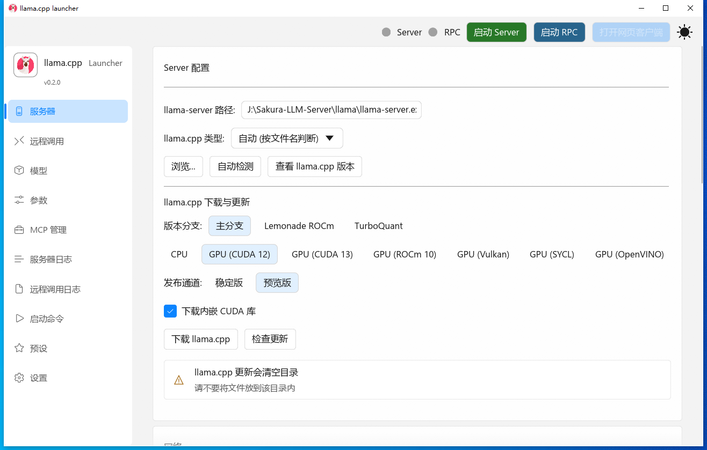
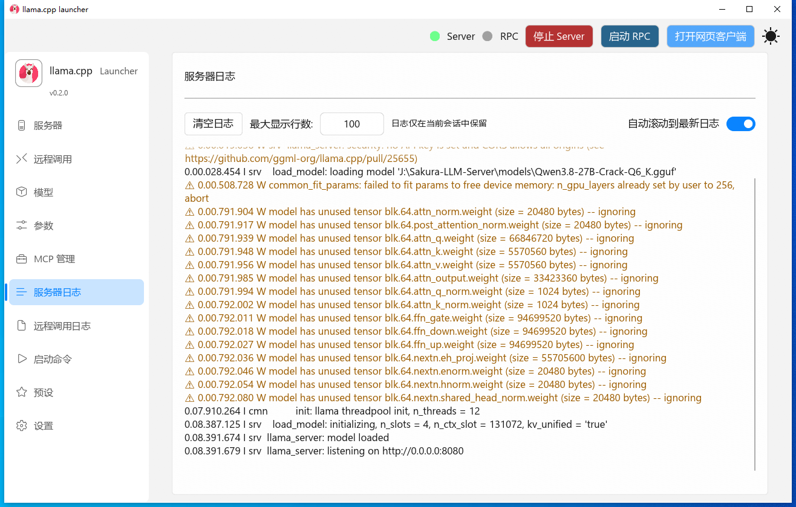
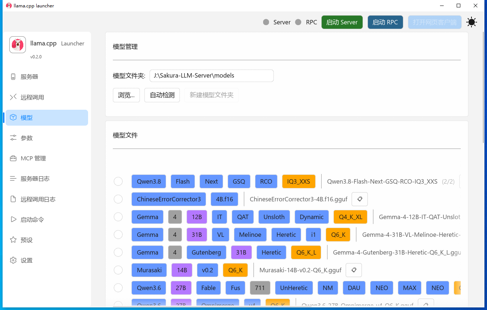

<div align="center">

# llama.cpp-launcher

[](README_EN.md) [](README.md)

</div>

❓ **这是什么？**

这是一个用 Rust 构建的轻量级桌面启动器，用于管理 llama.cpp（含 KVMem 分支）与 ggml-rpc-server。提供 Fluent 3（WinUI 3）图形界面，支持进程管理、预设系统、可视化配置、llama.cpp 一键下载、应用自更新、实时日志与中英文界面。

📸 **屏幕截图**

**服务器配置面板**


**服务器日志面板**


**模型管理面板**


✨ **有什么特点？**

- 🎨 基于 eframe/egui 0.35 + Fluent 3（WinUI 3）的跨平台 GUI，深色/浅色主题 + Mica 背景
- ⚙️ 可视化配置 llama.cpp 服务器参数（端口、线程、GPU 层数、Flash Attention 等）
- 🧠 支持 KVMem（llama-kvmem-server 分支，KV 内存优化）
- 📁 文件浏览器选择模型文件（支持 .gguf 格式）
- 🔍 模型文件彩色标签解析（9 色自动识别参数量、量化类型、版本号等）
- 📊 KV 缓存估算 - 自动计算显存可用最大上下文
- 💾 预设系统 - 保存和加载常用配置，支持开机自动应用
- 📤 预设共享 - 导出/导入、共享窗口、RPC 卡片
- 📊 实时日志显示（Server 与 RPC 独立日志流，支持文件日志记录）
- 📋 启动命令预览（只读展示最终命令）
- 🎯 支持 Web UI 集成（一键打开网页客户端）
- 📱 支持 RPC 模式（ggml-rpc-server，分布式推理）
- 🔌 MCP 服务器配置
- 🌐 支持中英文界面（自动检测系统语言）
- 🚀 开机自启支持（Windows 注册表）
- 🔗 桌面快捷方式创建（Windows）
- ⬇️ llama.cpp 一键下载（官方/镜像/nightly，按地理位置自动选择镜像源）
- 🔄 应用自更新（Windows 热更新）

🚀 **如何安装？**

### 下载预构建版本（推荐）

从 [GitHub Releases](https://github.com/yihuishou/llama.cpp-launcher/releases) 下载对应平台二进制（Windows x64/arm64、Linux x64/aarch64）。

### 从源码构建

```bash
# 克隆仓库
git clone https://github.com/yihuishou/llama.cpp-launcher.git
cd llama.cpp-launcher

# 构建发布版本
cargo build --release

# 可执行文件位于
# target/release/llama_cpp_launcher.exe
```

### 依赖要求

- Rust 1.70+
- Windows: 需要 Visual Studio Build Tools 或 MinGW
- Linux: 需要 X11 开发库

⚡ **快速使用？**

1. 下载 [llama.cpp 发布版](https://github.com/ggml-org/llama.cpp/releases) 并解压（或使用内置下载器自动获取）
2. 将启动程序放在 和 llama.cpp 同级目录
3. 启动应用程序，选择 Server 面板
4. 点击 自动检测 按钮，程序将自动查找 llama.cpp 服务器执行程序
5. 配置服务器参数（端口、线程数等）
6. 选择 模型管理 面板，点击 自动检测 按钮，程序将自动查找同级目录内的 models 或 model 文件夹并显示其中的模型文件
7. 选择要运行的模型文件（.gguf 格式）
8. 点击 启动Server 按钮
9. 待 打开网页客户端 按钮亮起，即可点击按钮打开 Web 界面

📖 **详细文档在哪里？**

- 📄 [项目架构文档](AGENTS.md) - 了解项目结构和模块设计
- 📚 [llama-server 参数参考](doc/server-parameter-v0.6.0.txt)
- 📚 [rpc-server 参数参考](doc/rpc-server-parameter-v0.6.0.txt)
- 📚 [kvmem-server 参数参考](doc/kvmem-server-parameter-beta2.txt)
- 🐛 [问题反馈](https://github.com/yihuishou/llama.cpp-launcher/issues)
- 💬 [讨论区](https://github.com/yihuishou/llama.cpp-launcher/discussions)

🤝 **如何贡献？**

1. Fork 项目
2. 创建功能分支 (`git checkout -b feature/AmazingFeature`)
3. 提交更改 (`git commit -m 'Add some AmazingFeature'`)
4. 推送到分支 (`git push origin feature/AmazingFeature`)
5. 创建 Pull Request

### 开发设置

```bash
# 安装依赖
cargo build

# 运行测试
cargo test

# 代码格式化
cargo fmt

# 代码检查
cargo clippy
```

📄 **用什么许可证？**

本项目采用 [MIT 许可证](LICENSE) - 查看 LICENSE 文件了解详情。

---

**项目结构：**
```
src/
├── main.rs            # 入口：logger、--updater-switch、--minimized、native_options、字体加载
├── app.rs             # LlamaLauncherApp：路由/菜单/DWM-Mica/开机自启
├── config/            # 配置管理
│   └── settings.rs    # AppSettings, Preset, GpuLayersMode, LlamaCppType 定义与序列化
├── engine/            # 进程管理
│   ├── server.rs      # ServerManager - llama-server 生命周期管理
│   ├── rpc.rs         # RpcManager - rpc-server 生命周期管理
│   └── mod.rs         # ErrorInfo 错误类型
├── ui/                # GUI 面板（10 个面板 + 共享组件）
│   ├── server_panel.rs        # 服务器配置面板
│   ├── rpc_panel.rs           # RPC 配置面板
│   ├── model_panel.rs         # 模型选择面板（彩色标签解析）
│   ├── params_panel.rs        # 参数配置面板
│   ├── log_panel.rs           # 实时日志面板
│   ├── launch_commands_panel.rs  # 启动命令预览
│   ├── presets_panel.rs       # 预设管理面板
│   ├── preset_share.rs        # 预设共享（导出/导入）
│   ├── settings_panel.rs      # 设置面板
│   ├── mcp_panel.rs           # MCP 配置面板
│   ├── widgets.rs             # 共享控件
│   └── helper.rs              # 帮助按钮组件
├── i18n.rs            # 国际化支持（中英文）
├── kv_cache.rs        # KV 缓存 / 最大上下文估算
├── downloader.rs      # llama.cpp 下载器（官方/镜像/nightly）
├── updater.rs         # 应用自更新（Windows 热更新 + waiter 进程）
├── theme.rs           # Fluent 3 主题，accent color
├── geo.rs             # 地理位置检测（镜像源优先级）
├── net_proxy.rs       # ureq Agent（连接超时 + 系统代理）
├── shortcut.rs        # Windows 快捷方式创建
└── spacing_debugger.rs  # UI 间距调试工具
```

**技术栈：**
- 🦀 Rust 2021
- 🖼️ eframe/egui 0.35（GUI 框架）
- 🎨 fluent-egui 0.1.1（WinUI 3 Fluent 3 主题/控件）
- 🔢 iconflow 2.1（图标字体）
- 📦 serde/serde_json（配置序列化）
- 📁 rfd（文件对话框）
- ⬇️ ureq/zip/tar/flate2（llama.cpp 下载与解压）
- 🔄 poll-promise（异步任务）
- 🔧 gguf-rs（GGUF 模型文件解析）
- 📋 arboard（剪贴板）
- 🌍 sys-locale（系统语言检测）
- ⏱️ chrono（时间日期处理）
- 📁 dirs（系统目录获取）
- 🔧 shortcuts-rs（Windows 快捷方式创建）

**支持的平台：**
- ✅ Windows 10/11（x64 / arm64）
- ✅ Linux（X11，x64 / aarch64）

**相关链接：**
- [llama.cpp](https://github.com/ggml-org/llama.cpp) - 核心推理引擎
- [egui](https://github.com/emilk/egui) - GUI 框架
- [eframe](https://github.com/emilk/egui/tree/master/crates/eframe) - 原生应用框架
