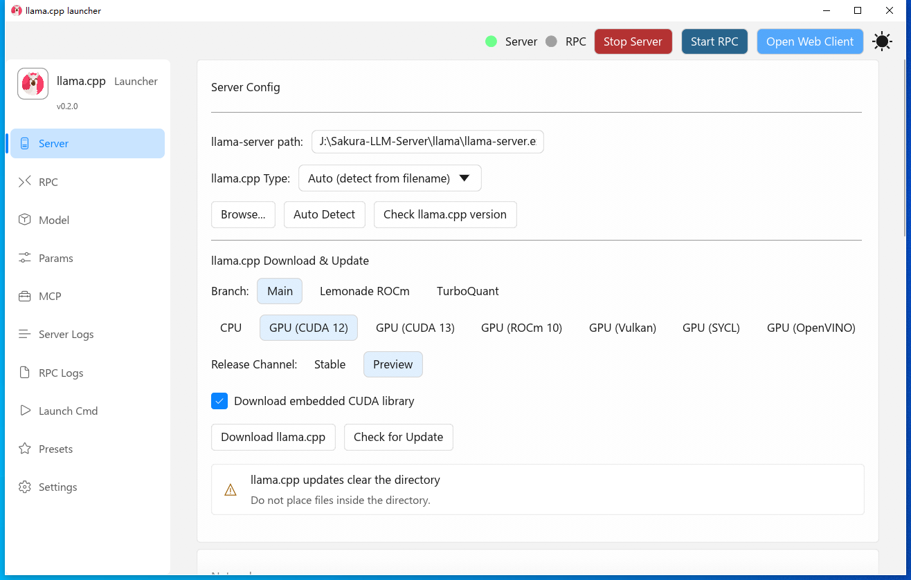
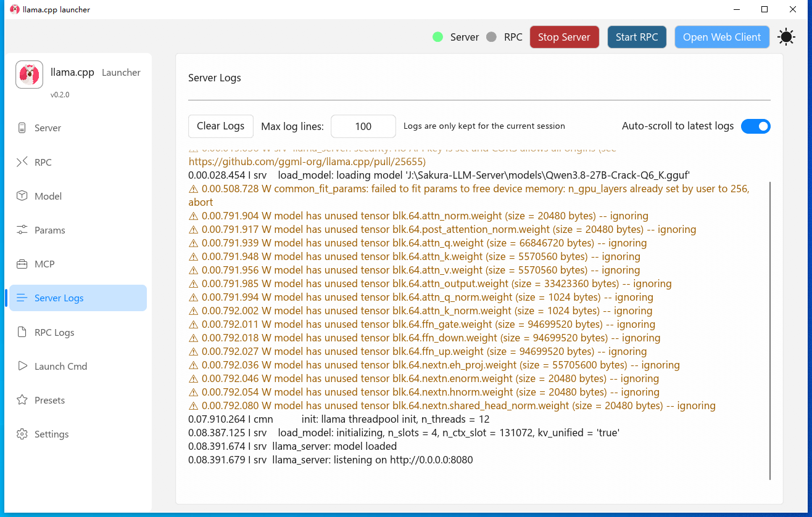
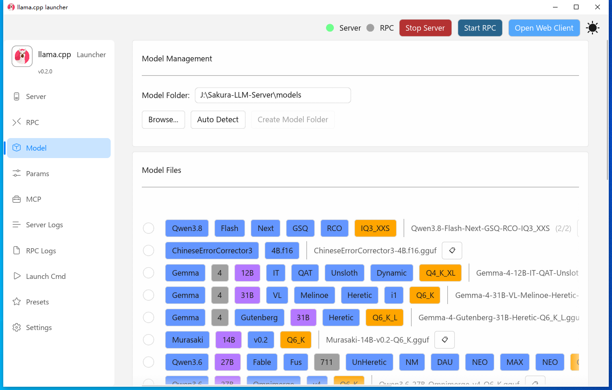

<div align="center">

# llama.cpp-launcher

[](README_EN.md) [](README.md)

</div>

❓ **What is this?**

A lightweight desktop launcher built with Rust for managing llama.cpp (including the KVMem fork) and ggml-rpc-server. It provides a Fluent 3 (WinUI 3) graphical interface supporting process management, a preset system, visual configuration, one-click llama.cpp download, app self-update, real-time logs, and a Chinese/English UI.

📸 **Screenshots**

**Server Configuration Panel**


**Server Log Panel**


**Model Management Panel**


✨ **Features**

- 🎨 Cross-platform GUI based on eframe/egui 0.35 + Fluent 3 (WinUI 3), with dark/light themes and a Mica backdrop
- ⚙️ Visual configuration of llama.cpp server parameters (port, threads, GPU layers, Flash Attention, etc.)
- 🧠 KVMem support (llama-kvmem-server fork, KV memory optimization)
- 📁 File browser to select model files (.gguf format)
- 🔍 Colorful model file tag parsing (9-color auto-identification of parameter count, quantization type, version, etc.)
- 📊 KV cache estimation — auto-calculate the maximum context available from VRAM
- 💾 Preset system — save and load frequently used configurations, with auto-apply on boot
- 📤 Preset sharing — export/import, share window, RPC card
- 📊 Real-time log display (separate Server and RPC log streams, with file logging support)
- 📋 Launch command preview (read-only view of the final command)
- 🎯 Web UI integration (one-click open of the web client)
- 📱 RPC mode support (ggml-rpc-server, distributed inference)
- 🔌 MCP server configuration
- 🌐 English and Chinese interface (auto-detect system language)
- 🚀 Auto-start on boot (Windows registry)
- 🔗 Desktop shortcut creation (Windows)
- ⬇️ One-click llama.cpp download (official/mirror/nightly, mirror source auto-selected by geo location)
- 🔄 App self-update (Windows hot update)

🚀 **Installation**

### Download a Prebuilt Release (Recommended)

Download the binary for your platform from [GitHub Releases](https://github.com/yihuishou/llama.cpp-launcher/releases) (Windows x64/arm64, Linux x64/aarch64).

### Build from Source

```bash
# Clone the repository
git clone https://github.com/yihuishou/llama.cpp-launcher.git
cd llama.cpp-launcher

# Build release version
cargo build --release

# Executable located at
# target/release/llama_cpp_launcher.exe
```

### Requirements

- Rust 1.70+
- Windows: Visual Studio Build Tools or MinGW
- Linux: X11 development libraries

⚡ **Quick Start**

1. Download the [llama.cpp release](https://github.com/ggml-org/llama.cpp/releases) and extract it (or use the built-in downloader to fetch it automatically)
2. Place the launcher in the same directory as llama.cpp
3. Launch the application and select the Server tab
4. Click the Auto Detect button — the program will automatically find the llama.cpp server executable
5. Configure server parameters (port, threads, etc.)
6. Select the Model tab, click Auto Detect — the program will find `models` or `model` folders in the same directory and display model files
7. Select the model file to run (.gguf format)
8. Click the Start Server button
9. Once the Open Web Client button lights up, click to open the Web UI

📖 **Documentation**

- 📄 [Project Architecture](AGENTS.md) — learn about project structure and module design
- 📚 [llama-server parameter reference](doc/server-parameter-v0.6.0.txt)
- 📚 [rpc-server parameter reference](doc/rpc-server-parameter-v0.6.0.txt)
- 📚 [kvmem-server parameter reference](doc/kvmem-server-parameter-beta2.txt)
- 🐛 [Issue Tracker](https://github.com/yihuishou/llama.cpp-launcher/issues)
- 💬 [Discussions](https://github.com/yihuishou/llama.cpp-launcher/discussions)

🤝 **Contributing**

1. Fork the project
2. Create a feature branch (`git checkout -b feature/AmazingFeature`)
3. Commit changes (`git commit -m 'Add some AmazingFeature'`)
4. Push to the branch (`git push origin feature/AmazingFeature`)
5. Create a Pull Request

### Development Setup

```bash
# Install dependencies
cargo build

# Run tests
cargo test

# Format code
cargo fmt

# Lint code
cargo clippy
```

📄 **License**

This project is licensed under the [MIT License](LICENSE) — see the LICENSE file for details.

---

**Project Structure:**
```
src/
├── main.rs            # Entry: logger, --updater-switch, --minimized, native_options, font loading
├── app.rs             # LlamaLauncherApp: routing/menu/DWM-Mica/auto-start
├── config/            # Configuration management
│   └── settings.rs    # AppSettings, Preset, GpuLayersMode, LlamaCppType definitions and serialization
├── engine/            # Process management
│   ├── server.rs      # ServerManager - llama-server lifecycle management
│   ├── rpc.rs         # RpcManager - rpc-server lifecycle management
│   └── mod.rs         # ErrorInfo error type
├── ui/                # GUI panels (10 panels + shared components)
│   ├── server_panel.rs        # Server configuration panel
│   ├── rpc_panel.rs           # RPC configuration panel
│   ├── model_panel.rs         # Model selection panel (colorful tag parsing)
│   ├── params_panel.rs        # Parameter configuration panel
│   ├── log_panel.rs           # Real-time log panel
│   ├── launch_commands_panel.rs  # Launch command preview
│   ├── presets_panel.rs       # Preset management panel
│   ├── preset_share.rs        # Preset sharing (export/import)
│   ├── settings_panel.rs      # Settings panel
│   ├── mcp_panel.rs           # MCP configuration panel
│   ├── widgets.rs             # Shared widgets
│   └── helper.rs              # Help button component
├── i18n.rs            # Internationalization (Chinese/English)
├── kv_cache.rs        # KV cache / max context estimation
├── downloader.rs      # llama.cpp downloader (official/mirror/nightly)
├── updater.rs         # App self-update (Windows hot update + waiter process)
├── theme.rs           # Fluent 3 theme, accent color
├── geo.rs             # Geo location detection (mirror source priority)
├── net_proxy.rs       # ureq Agent (connection timeout + system proxy)
├── shortcut.rs        # Windows shortcut creation
└── spacing_debugger.rs  # UI spacing debugging tool
```

**Tech Stack:**
- 🦀 Rust 2021
- 🖼️ eframe/egui 0.35 (GUI framework)
- 🎨 fluent-egui 0.1.1 (WinUI 3 Fluent 3 theme/controls)
- 🔢 iconflow 2.1 (icon font)
- 📦 serde/serde_json (configuration serialization)
- 📁 rfd (file dialog)
- ⬇️ ureq/zip/tar/flate2 (llama.cpp download and extraction)
- 🔄 poll-promise (async tasks)
- 🔧 gguf-rs (GGUF model file handling)
- 📋 arboard (clipboard)
- 🌍 sys-locale (system language detection)
- ⏱️ chrono (date/time handling)
- 📁 dirs (system directory access)
- 🔧 shortcuts-rs (Windows shortcut creation)

**Supported Platforms:**
- ✅ Windows 10/11 (x64 / arm64)
- ✅ Linux (X11, x64 / aarch64)

**Related Links:**
- [llama.cpp](https://github.com/ggml-org/llama.cpp) — Core inference engine
- [egui](https://github.com/emilk/egui) — GUI framework
- [eframe](https://github.com/emilk/egui/tree/master/crates/eframe) — Native application framework
